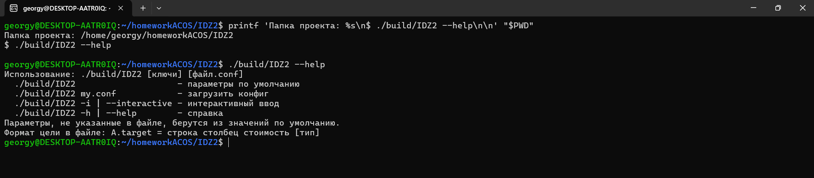
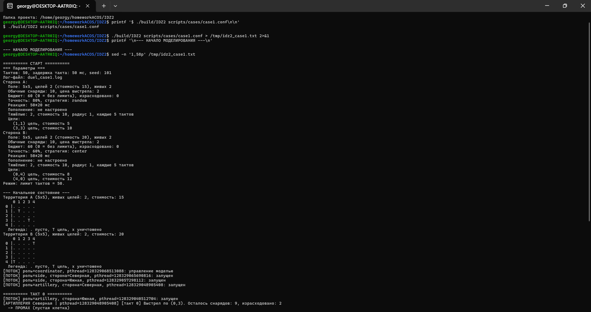
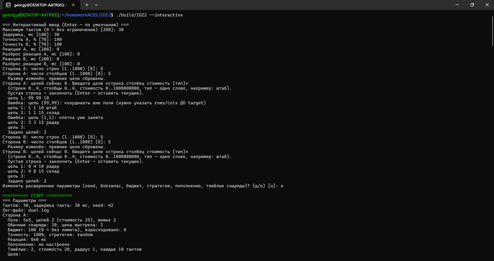
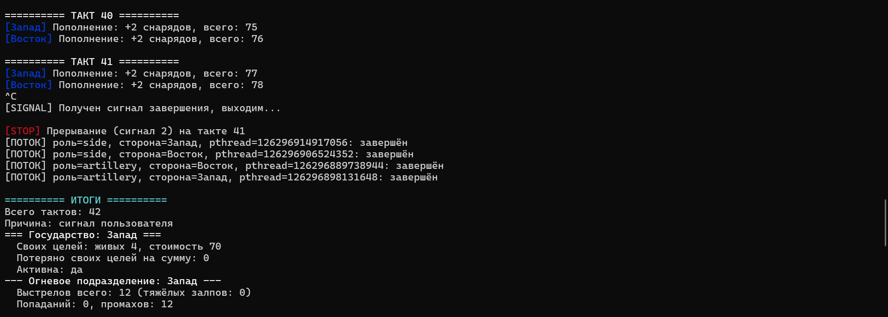
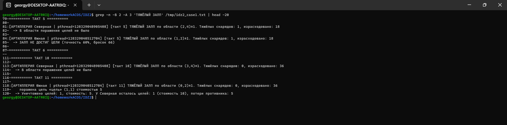
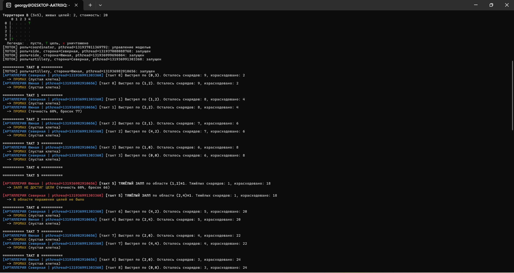
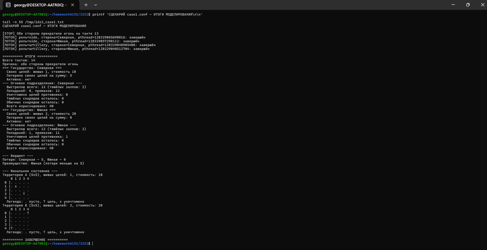
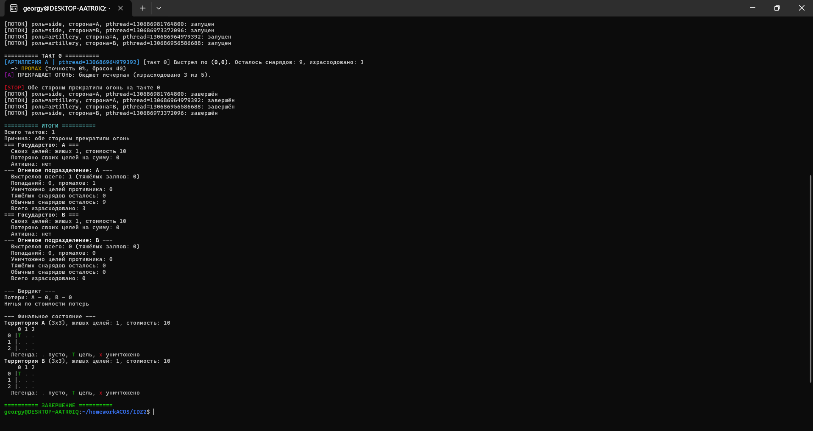
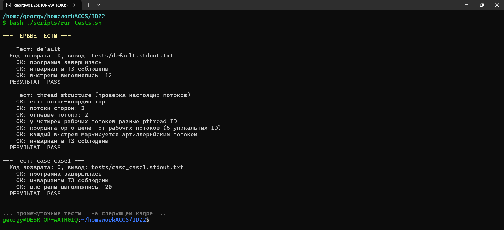
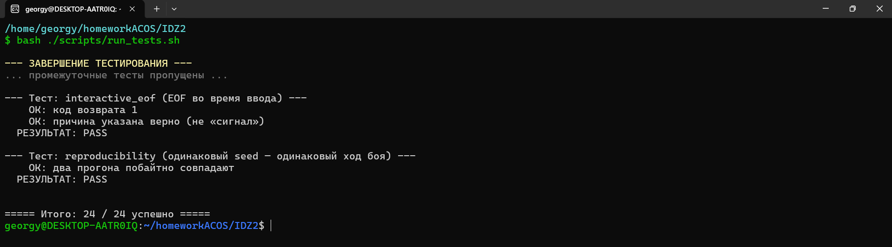

# Отчёт по индивидуальному заданию №2

**Курс:** «Архитектура компьютеров и операционные системы»  
**Тема:** Разработка многопоточной программы на языке C с POSIX Threads  
**Вариант:** 7 «Два условных государства» (модель миномётного обстрела)  
**Исполнитель:** Андрюшко Георгий Павлович  
**Группа:** БПИ253  
**Год:** 2026  

---

## 1. Условие задачи

Два условных государства расположены на прямоугольных клеточных
территориях. На территории каждой стороны размещены цели различного
типа и стоимости. Стороны независимо и асинхронно производят
миномётные выстрелы по координатам территории противника.

Выбор цели может быть случайным или определяться заданной стратегией.
Противники не знают координат целей друг друга.

Попадание в неповреждённую цель уничтожает её и уменьшает суммарную
стоимость оставшихся объектов. Повторное попадание в разрушенную или
пустую клетку не даёт результата. Каждая сторона располагает запасом
снарядов; при расширенном моделировании запас может пополняться с
заданной интенсивностью.

Боевые действия стороны прекращаются, если уничтожены все её цели,
у противника не осталось живых целей, исчерпан боеспособный запас снарядов
(с учётом возможного пополнения) либо следующий выстрел превысил бы бюджет.
Если расходы после выстрела ровно равны бюджету, этот выстрел допустим.

**Требуется:** разработать консольное приложение, моделирующее
действия двух сторон.

**Входные параметры:** размеры территорий, число/расположение/стоимость
целей, число и стоимость снарядов, интервалы между выстрелами,
точность и стратегия выбора координат, правила пополнения запасов,
условия экономического прекращения огня.

**Отображаемые события:** выстрел, координаты цели, промах, попадание,
уничтожение объекта, остаток снарядов, стоимость потерь, текущее
состояние обеих территорий.

**Инварианты:**

- выстрел расходует не более одного снаряда;
- одна цель учитывается уничтоженной только один раз;
- стоимость и число оставшихся объектов не становятся отрицательными;
- каждая сторона изменяет только состояние территории противника
  посредством зарегистрированного выстрела;
- событие завершения останавливает новые выстрелы соответствующей стороны.

**Завершение:** моделирование завершается при выполнении условия
прекращения для обеих сторон, либо при достижении общего ограничения
числа тактов, либо по прерыванию пользователем, если задан режим
неограниченного по времени выполнения.

**Участники модели:** обе стороны, их огневые подразделения и координатор
моделирования являются самостоятельными участниками модели.

---

## 2. Сценарий: сущности → процессы и типы данных

Программа реализована как **многопоточное консольное приложение** на C11
с POSIX Threads (`pthread`). Стороны и огневые подразделения представлены
отдельными потоками; главный поток выступает координатором моделирования.
Всего одновременно работают пять участников: два потока сторон, два
огневых потока и координатор.

**Сущности, типы данных и ответственность:**

- **Государство A/B (`side_t`).** Поток `side_worker`; функции `side_check_done`, `side_replenish`. Проверка условий прекращения огня и пополнение запасов.
- **Огневое подразделение A/B (`artillery_t`).** Поток `artillery_worker`; функции `side_fire`, `side_area_strike`. Выбор координат, обычные и площадные выстрелы, учёт боезапаса и бюджета.
- **Территория (`grid_t`).** Функции `grid_at`, `grid_place_target`, `grid_print`. Клеточное поле и размещение целей.
- **Цель (`cell_t`).** Состояние меняется при `side_fire`/`side_area_strike`; переход в `CELL_DESTROYED` учитывается только один раз.
- **Стратегия (`strategy_t`).** Функция `artillery_pick_coords`; варианты `random`, `center`, `sector`, без знания расположения целей.
- **Координатор.** `simulation_run` в `simulation.c`; функции `start_tick`, `wait_for_tick_or_event`. Начало тактов, глобальное завершение и обработка сигналов.
- **Параметры (`config_t`).** `config_defaults`, `config_load`, `config_read_stdin`, `config_print`. Загрузка и хранение настроек.

**Анализ: какие сущности могут быть потоками.** Поток нужен сущности, у которой
есть собственное поведение во времени (действует независимо от других и сама
решает, когда действовать). Пассивные данные и чистые функции потоками не делаются.

- **Огневые подразделения A и B — да.** Независимо выбирают момент и координаты выстрела, имеют собственный таймер реакции и ГПСЧ.
- **Государства A и B — да.** На каждом такте пополняют запас и проверяют условия прекращения огня своей стороны.
- **Координатор — да, основной поток.** Ведёт такты, решает о глобальном завершении и принимает сигналы остановки.
- **Территория и цель — нет.** Это пассивные данные; изменения происходят при выстреле под блокировкой.
- **Стратегия выбора координат — нет.** Это функция, вызываемая внутри огневого потока.
- **Снаряд и залп — нет.** Это события внутри выстрела, а не самостоятельная длительная активность.
- **Параметры — нет.** После запуска они используются как настройки модели.
- **Логгер — нет.** Это общий ресурс, защищённый собственным мьютексом.

Итого пять потоков: два государства, два огневых подразделения и координатор — ровно
«стороны, огневые подразделения и координатор» из условия.

**Синхронизация.** Все чтения и изменения общего состояния модели выполняются
под `pthread_mutex_t`. Поэтому расход боеприпаса, изменение клетки и учёт
потерь являются атомарными относительно другого огневого потока. POSIX-семафоры
используются для согласования тактов: `tick_sem[]` уведомляют потоки сторон о новом
такте, `tick_ack[]` подтверждают обработку такта, `event_sem` будит координатор при
появлении события, а в режиме быстрого моделирования (`tick_ms=0`) `fire_sem[]`
разрешают огневому потоку выстрел такта и `fire_ack[]` подтверждают, что такт
отработан (координатор не начинает следующий, пока оба подразделения не сходили).
Вывод защищён отдельным мьютексом логгера. Флаги сигналов — C11-атомарные. У каждой стороны
собственное состояние генератора псевдослучайных чисел, чтобы параллельные
вызовы не обращались к общему `rand()`.

**Сценарий работы:**

1. **Инициализация** — обработчики сигналов, загрузка параметров,
   открытие лога, вывод стартовых карт, создание mutex/семафоров и рабочих потоков.
2. **Такт моделирования** — координатор задаёт текущий такт; стороны выполняют
   пополнение и проверяют условия завершения; огневые потоки независимо
   выбирают координаты и стреляют при готовности. Перед выстрелом под той же
   блокировкой стрелок проверяет условия прекращения огня для своей стороны;
   после выстрела при изменении состояния выводятся обе карты. Флаги завершения
   противника обновляет он сам перед своим выстрелом либо координатор — стрелок
   меняет у противника только территорию.
3. **Завершение** — координатор выставляет общий флаг остановки, разблокирует
   ожидающие потоки, присоединяет их через `pthread_join`; затем формируются
   статистика, вердикт и финальные карты, закрывается лог.

---

## 3. Пользовательский интерфейс

### 3.1. Командная строка

```
./build/IDZ2                          — параметры по умолчанию
./build/IDZ2 my.conf                  — загрузка из файла
./build/IDZ2 --interactive | -i       — интерактивный ввод
./build/IDZ2 --help | -h              — справка
```



### 3.2. Формат конфигурационного файла

Текстовый формат `key = value`. Комментарии начинаются с `#`.

**Глобальные параметры:** `max_ticks`, `tick_ms`, `seed`, `log`.

**Параметры стороны** (префикс `A.` или `B.`): `name`, `rows`, `cols`,
`ammo`, `ammo_cost`, `budget`, `accuracy`, `strategy`,
`replenish_every`, `replenish_amount`, `reaction_ms`,
`reaction_jitter_ms`, `area_ammo`, `area_cost`, `area_radius`,
`area_every`, `target` (формат: `строка столбец стоимость [тип]`).

Цели различаются **типом** (одно слово: штаб, склад, батарея…; по умолчанию «цель»)
и стоимостью 0..10⁹. Недопустимая цель отклоняется: запуск прекращается с кодом 1 и
сообщением о причине. Параметры, не указанные в файле, принимают значения по
умолчанию (бюджет 100, два тяжёлых снаряда каждые 10 тактов и т.д.).

### 3.3. Вывод программы

Вывод информативен, отражает все ключевые события предметной области:

- параметры обеих сторон (поле, цели, боезапас, бюджет, точность,
  стратегия, пополнение, реакция, тяжёлые снаряды);
- цветная ASCII-карта территорий с координатными осями;
- каждое событие выстрела с координатами, остатком снарядов и расходом;
- промах/попадание с указанием причины и текущих потерь противника;
- сообщения о пополнении и о прекращении огня;
- итоговая статистика и вердикт.



Отдельный скриншот показывает реальные роли потоков и разные `pthread` ID координатора, обоих потоков сторон и обоих огневых потоков: [Многопоточность](screenshots/09_multithreading.png).

### 3.4. Интерактивный режим

При запуске с ключом `--interactive` программа последовательно
запрашивает у пользователя параметры:

1. **Общие:** максимум тактов, пауза между тактами (`0` — быстрое моделирование).
2. **Для каждой стороны:**
    - точность стрельбы (0–100), задержка реакции и её разброс;
    - размеры территории — число строк и столбцов (1–1000);
    - список целей в формате `строка столбец стоимость [тип]`.
3. **Расширенные параметры** (по запросу «д/н»): seed и для каждой стороны число и
   цена обычных снарядов, бюджет, стратегия, пополнение (период, количество) и
   тяжёлые снаряды (число, цена, радиус, период). Для проверки значений
   используется тот же код, что и для конфигурационного файла.

Ввод целей выполняется в цикле, по одной в строке. Пустая строка
завершает ввод; если сразу нажать Enter, текущие цели сохраняются,
а если ввести хотя бы одну — прежний набор заменяется новым.

Все вводимые значения **валидируются**:

- числовые параметры проверяются на диапазон;
- для целей проверяются координаты (границы поля), стоимость
  (0..1000000000), формат строки, отсутствие повторного размещения
  на занятой клетке.

При ошибке ввода значение отклоняется с сообщением, и программа
продолжает запрос. Работа прерывается корректно по `Ctrl+C` (код 0); если входной
поток закончился до окончания ввода, выводится сообщение об этом и возвращается код 1.



### 3.5. Логирование

Все события дублируются в лог-файл. ANSI-escape-последовательности
при записи **вырезаются** — лог остаётся чистым текстом.

### 3.6. Цветной вывод

ANSI-цвета: зелёный `T`, красный `x`, жёлтый — промахи, зелёный —
попадания, красный жирный — тяжёлые залпы. Цвета автоматически
отключаются при перенаправлении вывода в файл.

---

## 4. Варианты запуска и завершения

### 4.1. Способы запуска

1. **Параметры по умолчанию** — `./build/IDZ2`.
2. **Из файла** — `./build/IDZ2 scripts/cases/case1.conf`.
3. **Интерактивный ввод** — `./build/IDZ2 --interactive`.

Интерактивный режим позволяет задать не только такты, задержку и
точность, но и **размеры территорий и список целей** для каждой
стороны. Все вводимые значения валидируются.

### 4.2. Варианты завершения

Ключевая идея: программа может выполняться долго или бесконечно
в зависимости от данных (вполне корректных). Поэтому она должна
корректно завершаться **двумя принципиально разными способами**:
естественно (когда данные это позволяют) или по прерыванию
пользователем. Оба реализованы и работают.

**А. Естественное** — программа останавливается сама:

- сторона прекращает огонь, если у неё уничтожены все собственные
  цели, у противника не осталось живых целей, закончились боеприпасы
  (и пополнение не настроено либо его не позволит бюджет) или бюджет не позволяет
  следующий выстрел. Прекращение окончательное: сторона не возобновляет огонь;
- моделирование заканчивается, когда прекратили огонь обе стороны;
- либо достигнут общий лимит тактов `max_ticks` (если он задан).

**Б. По прерыванию** — при получении сигнала `SIGINT` (Ctrl+C) или
`SIGTERM`. Работает в том числе в режиме неограниченного времени
(`max_ticks = 0`), когда естественное завершение невозможно.

Программа многопоточная. Для каждой стороны созданы отдельные потоки
обслуживания состояния и огневого подразделения, а главный поток выполняет
роль координатора. Рабочие потоки взаимодействуют через общую mutex-блокировку
и POSIX-семафоры. Реакция каждого огневого подразделения рассчитывается
независимо как `reaction_ms + случайная добавка`.



### 4.3. Гарантированно бесконечный сценарий

`case2.conf`: `max_ticks=0`, `accuracy=0`, пополнение `+2/такт`.
Естественное завершение невозможно — только сигнал.

### 4.4. Инвариант «завершение останавливает выстрелы»

Условия проверяются потоком стороны на каждом такте, а огневым потоком — **непосредственно перед выстрелом под той же блокировкой**, что и сам выстрел. Поэтому другой огневой поток не может вклиниться между уничтожением последней цели и фиксацией прекращения огня: сторона, у которой только что уничтожили последнюю цель, перед своим выстрелом обнаружит это и не выстрелит. Координатор дополнительно обновляет флаги обеих сторон по уведомлению о событии.

### 4.5. Режимы времени и особенности модели

- `tick_ms > 0` — такт длится `tick_ms` мс; огневой поток стреляет не чаще одного раза за такт и выдерживает задержку реакции, поэтому реальный интервал между выстрелами не короче такта.
- `tick_ms = 0` — быстрое моделирование: координатор ждёт, пока оба подразделения отработали такт (выстрел или пропуск), задержки реакции не применяются. Число выстрелов детерминировано. В прежней версии такты в этом режиме не были связаны с выстрелами: лимит тактов мог закончиться раньше, чем огневые потоки получали процессор.
- Экономическое ограничение применяется так: сторона прекращает огонь, когда следующий выстрел вывел бы израсходованную стоимость за предел бюджета (бюджет 5, цена 3 — один выстрел).
- Ожидание координатора нарезано на отрезки по 20 мс, поэтому остановка по `Ctrl+C` занимает единицы миллисекунд даже при `tick_ms=60000`.
- `SIGPIPE` игнорируется: при закрытом канале вывода (`| head`) консольный вывод отключается, а моделирование и лог-файл завершаются штатно.

---

## 5. Инварианты: как соблюдаются

- **Один выстрел — один снаряд.** `ammo_left--` или `area_ammo--` выполняется один раз за ход.
- **Цель учитывается только один раз.** Разрушение допускается только при переходе `CELL_TARGET → CELL_DESTROYED`.
- **Стоимость и число целей неотрицательны.** Стоимость одной цели проверяется на диапазон 0..10⁹ до записи в клетку; суммарные стоимости (`initial_cost`, `alive_cost`, `lost_cost`) хранятся в `int64_t`.
- **Сторона меняет только чужую территорию выстрелом.** `side_fire`/`side_area_strike` получают `victim->grid`; собственный флаг `active` сторона меняет сама.
- **После завершения новых выстрелов нет.** Условие проверяется непосредственно перед выстрелом под той же блокировкой; возобновления огня нет.

---

## 6. Интерфейсы POSIX и функции libc

**POSIX API, системные вызовы и интерфейсы потоков/семафоров:** `open`, `read`, `write`,
`close`, `nanosleep`, `sigaction`, `isatty`, `pthread_create`, `pthread_join`,
`pthread_mutex_lock`/`pthread_mutex_unlock`, `pthread_sigmask`, `sem_init`, `sem_wait`,
`sem_timedwait`, `sem_post`, `clock_gettime`. Обработчики `SIGINT`/`SIGTERM` выставляют
флаги остановки; `SIGPIPE` игнорируется.

**Используемые функции libc:** `malloc`/`calloc`/`free`, `snprintf`/`vsnprintf`,
`fprintf` (для диагностических сообщений командной строки в `stderr`), `strlen`, `strcmp`,
`strncpy`, `strchr`, `isspace`, `strtol`, `strtoll`, `strtoimax`, `memcpy`, `memset`.
Для случайных действий используется отдельный компактный xorshift32-генератор на каждое
подразделение вместо общего `rand()`; seed перемешивается финализатором MurmurHash3,
диапазон получается по старшим битам.

Построчное чтение интерактивного ввода и конфигурации, основной игровой вывод и логирование
реализованы через файловые дескрипторы (`read`/`open`/`write`/`close`). Несколько сообщений
об ошибках запуска в `main.c` выводятся через `fprintf(stderr, ...)`; поэтому в отчёте
не утверждается, что абсолютно все сообщения программы выводятся исключительно через
`write()`.

---

## 7. Результаты работы

Ниже приведены фрагменты вывода и иллюстративные снимки. Идентификаторы потоков в текстовых
фрагментах заменены на `<id>`. Для режима реального времени порядок событий и номера тактов
могут меняться между запусками (планировщик ОС), для `tick_ms=0` число выстрелов детерминировано.
Актуальный вывод автотестов `24/24` показан двумя связанными терминальными снимками:
первый фиксирует команду запуска и первые проверки, второй — два последних теста и общую сводку.

### 7.1. Сценарий 1 — базовая модель с тяжёлыми залпами

```
./build/IDZ2 scripts/cases/case1.conf
```

Поле 5×5, по 2 цели у каждой стороны, по 10 снарядов, бюджет 60, точность A=80%, B=60%,
реакция 50±20 мс при такте 50 мс. Бой идёт в реальном времени; в зафиксированном запуске
обе стороны прекратили огонь после 14 тактов; в журнале тяжёлые залпы, промахи, попадания, карты и статистика. Пример:

```
[АРТИЛЛЕРИЯ Южная | pthread=<id>] [такт 5] ТЯЖЁЛЫЙ ЗАЛП по области (1,2)±1. Тяжёлых снарядов: 1, израсходовано: 18
  -> ЗАЛП НЕ ДОСТИГ ЦЕЛИ (точность 60%, бросок 66)
```

Seed задаёт независимые последовательности случайных решений сторон, но не фиксирует
расписание потоков; в режиме реального времени чередование событий может отличаться.





Итоговая статистика формируется координатором после присоединения всех рабочих потоков:
оставшиеся цели и их стоимость, потери, число выстрелов/попаданий/промахов, остатки
боеприпасов, расходы и вердикт.



### 7.2. Сценарий 2 — бесконечный режим, прерывание по SIGINT

```
./build/IDZ2 scripts/cases/case2.conf
# через 5 секунд: Ctrl+C
```

Поле 10×10, `accuracy=0`, пополнение +2 каждый такт, `max_ticks=0`. Естественное завершение
невозможно: прерывание обрабатывает координатор, рабочие потоки завершаются, выводятся итоги.

```
^C
[SIGNAL] Получен сигнал завершения, выходим...

[STOP] Прерывание (сигнал 2) на такте 21

========== ИТОГИ ==========
Причина: сигнал пользователя
...
========== ЗАВЕРШЕНИЕ ==========
```

Реакция на сигнал не зависит от длительности такта: при `tick_ms=60000` остановка занимает
4–6 мс (ожидание нарезано на отрезки по 20 мс).

### 7.3. Сценарий 3 — разные радиусы тяжёлого залпа

```
./build/IDZ2 scripts/cases/case3_area.conf
```

A: радиус залпа 1, B: радиус 2. Проверяются разные радиусы поражения и прекращение стрельбы
после уничтожения последней цели.

### 7.4. Минимальный сценарий — проверка инварианта

```
./build/IDZ2 scripts/cases/case_tiny.conf
```

Поле 1×1, по одной цели, по одному снаряду, точность 100%, `tick_ms=0`. Какая из сторон
выстрелит первой, определяет планировщик, но результат всегда один: ровно один выстрел.

```
[АРТИЛЛЕРИЯ B | pthread=<id>] [такт 0] Выстрел по (0,0). Осталось снарядов: 0, израсходовано: 0
  -> ПОПАДАНИЕ! Уничтожена цель «цель» стоимостью 10. У A осталось целей: 0 (стоимость 0), потери противника: 10
[B] ПРЕКРАЩАЕТ ОГОНЬ: у противника не осталось целей.
[A] ПРЕКРАЩАЕТ ОГОНЬ: все свои цели уничтожены.

[STOP] Обе стороны прекратили огонь на такте 0
```

**Ключевой момент:** вторая сторона **не сделала ни одного выстрела** — инвариант «событие
завершения останавливает новые выстрелы» соблюдён: перед выстрелом сторона проверяет свои
условия под той же блокировкой. Автотест проверяет ровно 1 выстрел и 1 попадание.

### 7.5. Проверка причины остановки по бюджету

```
./build/IDZ2 scripts/cases/case_budget.conf
```

Цена выстрела 3, бюджет 5:

```
[B] ПРЕКРАЩАЕТ ОГОНЬ: закончились боеприпасы (обычные и тяжёлые).
[АРТИЛЛЕРИЯ A | pthread=<id>] [такт 0] Выстрел по (0,0). Осталось снарядов: 9, израсходовано: 3
[A] ПРЕКРАЩАЕТ ОГОНЬ: бюджет исчерпан (израсходовано 3 из 5).
```



### 7.6. Повторное попадание, типы целей, пополнение

`case_destroyed_cell.conf` — две цели (5 и 7) в поле 1×2, A стреляет случайно с точностью 100%:

```
[АРТИЛЛЕРИЯ A | pthread=<id>] [такт 0] Выстрел по (0,0). Осталось снарядов: 59, израсходовано: 1
  -> ПОПАДАНИЕ! Уничтожена цель «склад» стоимостью 5. У B осталось целей: 1 (стоимость 7), потери противника: 5
[АРТИЛЛЕРИЯ A | pthread=<id>] [такт 1] Выстрел по (0,0). Осталось снарядов: 58, израсходовано: 2
  -> ПРОМАХ (уже разрушена)
...
  -> ПОПАДАНИЕ! Уничтожена цель «радар» стоимостью 7. У B осталось целей: 0 (стоимость 0), потери противника: 12
```

Повторные выстрелы по разрушенной клетке результата не дают; стоимость потерь ровно 12.
Цели учитываются один раз.

`case_types.conf` показывает цели разных типов (`«штаб»`, `«радар»`, `«склад»`, тип по умолчанию
`«цель»`). `case_replenish.conf` — запас 0 и пополнение +1 за такт: за 5 тактов ровно 10
выстрелов и 10 пополнений, стороны не прекращают огонь при пустом запасе.

### 7.7. Режимы `tick_ms`

```
./build/IDZ2 scripts/cases/t_tick0.conf    # tick_ms=0:   3 такта, ~3 мс
./build/IDZ2 scripts/cases/t_tick500.conf  # tick_ms=500: 3 такта, ~1,0 с
```

При `tick_ms=0` координатор не ждёт реального времени, но и не обгоняет огневые потоки:
следующий такт начинается после того, как оба подразделения отработали текущий.
Поэтому в каждом такте стороны, способные стрелять, стреляют ровно один раз.

### 7.8. Проверка отсутствия переполнения

```
./build/IDZ2 scripts/cases/case_overflow.conf
```

Каждая сторона имеет 30 000 снарядов по 100 000. Сценарий идёт в быстром режиме и всегда
заканчивается после 30 000 тактов (все снаряды израсходованы):

```
Всего тактов: 30000
  Всего израсходовано: 3000000000
```

Расход 3·10⁹ превышает `INT_MAX` (2 147 483 647) — счётчики `int64_t` переполнения не дают.
Для сравнения, стоимость одной цели ограничена 10⁹; конфигурация со стоимостью 3 000 000 000
(`bad_cost.conf`) отклоняется с кодом 1 (раньше значение молча превращалось в −1 294 967 296).

### 7.9. Автотесты

```bash
bash ./scripts/run_tests.sh
```

24 теста. Каждый проверяет не только код возврата, но и содержимое вывода, а также инварианты
ТЗ по журналу событий (после «ПРЕКРАЩАЕТ ОГОНЬ» сторона не стреляет; остатки, число и
стоимость целей не отрицательны; число выстрелов в журнале равно статистике; попадания +
промахи = выстрелы). Сценарные проверки: ровно один выстрел в `case_tiny`; причина «бюджет»
и один выстрел в `case_budget`; 10 выстрелов и 10 пополнений в `case_replenish`; повторное
попадание и потери 12 в `case_destroyed_cell`; расход выше `INT_MAX` в `case_overflow`; радиус 0
и цена 0 без ложного «бюджет исчерпан» в `case_area_zero`; типы целей в `case_types`; отклонение
`bad_cost.conf`; закрытый канал вывода (`sigpipe`); интерактивный ввод всех параметров и EOF;
одинаковый ход боя при одном seed; структура потоков; SIGINT и SIGTERM.

```
===== Итого: 24 / 24 успешно =====
```

На первом скриншоте показаны команда запуска и первые три теста. Промежуточные проверки
пропущены только в кадре для краткости; все тесты выполнялись одним полным запуском.



На втором скриншоте показаны две последние проверки и итоговая строка `24 / 24 успешно`.



Полный набор прошёл под ASan/UBSan (`24/24`, без диагностик). В WSL2 прямой запуск TSan
завершался до старта программы с `FATAL: ThreadSanitizer: unexpected memory mapping`;
после запуска через `setarch -R` тесты TSan прошли `24/24`, предупреждений о гонках не было.

В дополнительной расширенной серии, выполненной ранее, проведено 320 быстрых прогонов.
В последней контрольной серии на текущей папке Ubuntu выполнены ещё 30 быстрых прогонов
(по 10 для `t_tick0`, `case_area_zero`, `case_overflow`) и 20 запусков реального времени
(по 5 для `case1`, `case3_area`, `case_area_delayed`, `t_tick500`); ошибок и зависаний не
наблюдалось. Отдельно вручную проверен интерактивный режим: поля `4×4`, цель A `1 1 10 штаб`, цель B `2 2 10 радар`, `seed=5`, обычный боезапас A=3 и B=2. Программа отобразила типы целей и параметры, провела бой, вывела итоги и завершилась штатно; все четыре рабочих потока были присоединены. Отдельный ручной запуск базового режима также завершился штатно, а ручные `Ctrl+C` и `SIGTERM` привели к обработке сигналов и завершению рабочих потоков.

Набор проверялся также на версии до исправлений: она не проходит 11 из 24 тестов.

Это не доказывает отсутствия всех возможных ошибок, но в проверенных сценариях ASan/UBSan и
TSan не сообщили диагностик, а дополнительные прогоны завершились успешно.

---

## 8. Дополнительно реализовано

1. Основной ввод-вывод через POSIX-файловые дескрипторы; диагностические ошибки CLI используют `fprintf(stderr, ...)` (см. раздел 6).
2. Многопоточная модель из пяти участников с pthread.
3. Синхронизация общей модели mutex-блокировкой и POSIX-семафорами; рукопожатие тактов в быстром режиме.
4. Отдельный мьютекс логгера; отдельный воспроизводимый ГПСЧ каждой стороны с перемешиванием seed.
5. Обработка `SIGINT` и `SIGTERM` с корректным присоединением потоков; игнорирование `SIGPIPE`;
   атомарные флаги и сохранение `errno` в обработчике.
6. Лог-файл без ANSI-мусора, без обрезания длинных строк.
7. Конфигурационные файлы (15 штук, включая отрицательный) и скрипт автотестов с проверкой содержимого и инвариантов.
8. Тяжёлый (площадной) залп; радиус 0 и бесплатный снаряд допустимы.
9. Три стратегии выбора координат.
10. Экономический лимит с раздельной диагностикой причины.
11. Регулируемые задержки; два режима времени.
12. Воспроизводимый seed ГСЧ.
13. ANSI-цвета с автоотключением при перенаправлении.
14. Координатные оси на картах.
15. Цели различного типа и стоимости.
16. Валидация конфигурации и интерактивный режим для всех параметров модели.

Не реализовано: дополнительная программа с другими синхропримитивами (условные переменные,
барьеры) — пункт 8 дополнительных требований.

## 9. Структура проекта

```
IDZ2/
├── CMakeLists.txt
├── README.md
├── REPORT.md
├── REPORT.docx
├── .gitignore
├── screenshots/         — скриншоты для отчёта
├── include/             — заголовки (.h), включая simulation.h
├── src/                 — исходники (.c), включая многопоточную simulation.c
└── scripts/
    ├── run_tests.sh
    └── cases/           — 15 тестовых конфигов
```

## 10. Сборка и запуск

```bash
mkdir -p build && cd build
cmake .. -G Ninja && ninja      # или: cmake .. && make
cd ..
./build/IDZ2 scripts/cases/case1.conf
bash ./scripts/run_tests.sh
```

---

## 11. Что изменилось по сравнению с ИДЗ1

ИДЗ2 развивает исходный проект, а не заменяет его другой предметной моделью. Основные правила дуэли и большинство пользовательских возможностей сохранены; главное изменение — переход от последовательной имитации действий к настоящему многопоточному выполнению с синхронизацией общего состояния.

1. **Модель выполнения.** В ИДЗ1 приложение было однопоточным: главный цикл по очереди обрабатывал сторону A, затем сторону B. Независимость действий лишь приближалась задержками и случайным временем реакции. В ИДЗ2 добавлен модуль `simulation.c` (`include/simulation.h`): главный поток-координатор управляет четырьмя рабочими потоками — двумя потоками сторон и двумя потоками артиллерии. Роли и идентификаторы `pthread` выводятся в журнал.

2. **Синхронизация потоков.** В ИДЗ1 примитивы межпоточной синхронизации не требовались, поскольку конкурентного доступа к данным не было. В ИДЗ2 общая модель защищена мьютексом, у логгера есть отдельный мьютекс, а POSIX-семафоры согласуют такты, выстрелы и события. В быстром режиме координатор дожидается подтверждения обработки такта огневыми потоками — это не позволяет завершить модель, перескочив через фактически не выполненные выстрелы при `tick_ms = 0`.

3. **Генерация случайных чисел.** В ИДЗ1 использовался общий для программы `rand()` с инициализацией через `srand()`. В ИДЗ2 у каждой стороны собственное состояние генератора и отдельная последовательность случайных решений. Фиксированный `seed` помогает воспроизводить случайные решения; при этом в режиме реального времени планировщик ОС всё ещё может менять порядок событий между потоками.

4. **Завершение и сигналы.** Обработка `SIGINT` и `SIGTERM` уже была предусмотрена в ИДЗ1. В ИДЗ2 её пришлось адаптировать к многопоточности: координатор инициирует остановку, ожидающие рабочие потоки освобождаются от ожидания, затем все созданные потоки присоединяются (`pthread_join`), а ресурсы синхронизации освобождаются. Это важно, чтобы программа завершалась без оставшихся рабочих потоков.

5. **Уточнение модели и проверок.** В ИДЗ2 добавлен тип цели: он задаётся в конфигурации или интерактивно и отображается при событиях попадания. Дополнительно усилены проверки граничных случаев и инвариантов: причины прекращения огня различаются, проверяется корректность числовых значений и длинного вывода, а тесты проверяют не только код возврата, но и ожидаемое содержимое журналов.

6. **Расширение тестового набора.** В ИДЗ1 было 11 конфигураций и результат `15 / 15` автотестов. В ИДЗ2 стало 15 конфигураций и 24 проверки; контрольный запуск завершился результатом `24 / 24 успешно`. Дополнительно проверялись сборки с ASan/UBSan и ThreadSanitizer, повторные прогоны и ручное завершение по `Ctrl+C` и `SIGTERM`.

**Что осталось прежним.** Сохранены прямоугольные сетки, цели и их стоимость, стратегии `random`, `center` и `sector`, точность стрельбы, тяжёлые площадные залпы, пополнение боезапаса, экономический лимит, конфигурационный и интерактивный ввод, цветной вывод, логирование без ANSI-последовательностей, итоговая статистика и условия завершения боя.

**Итог.** В ИДЗ1 была реализована основная игровая логика. В ИДЗ2 она перенесена в многопоточную архитектуру POSIX `pthread`, дополнена механизмами синхронизации и корректного завершения потоков, а также более строгими проверками поведения на граничных сценариях.

---

## Приложение А. Пример лога

Ниже — короткий фрагмент `duel_case1.log`. Файл содержит полный ход моделирования; ANSI-последовательности в лог не записываются.

```
========== СТАРТ ==========
Тактов: 50, задержка такта: 50 мс, seed: 101
Лог-файл: duel_case1.log
[АРТИЛЛЕРИЯ Южная | pthread=<id>] [такт 5] ТЯЖЁЛЫЙ ЗАЛП по области (1,2)±1
  -> ЗАЛП НЕ ДОСТИГ ЦЕЛИ (точность 60%, бросок 66)
...
========== ЗАВЕРШЕНИЕ ==========
```
