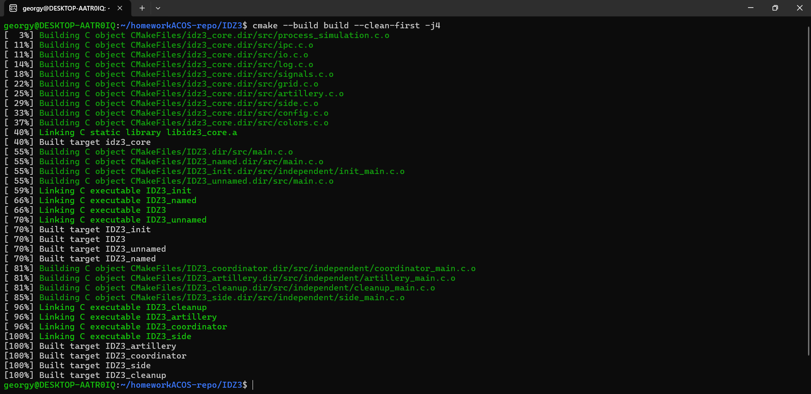
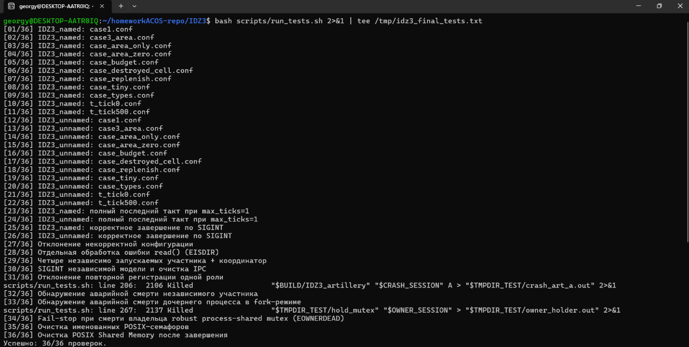
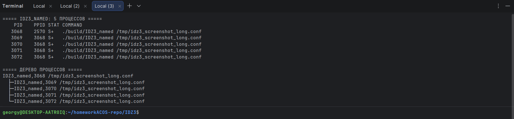
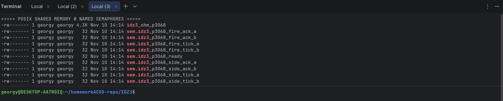
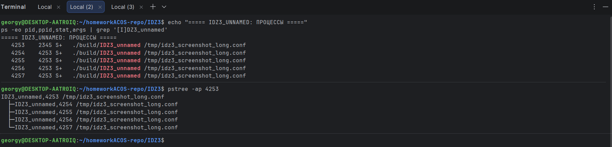
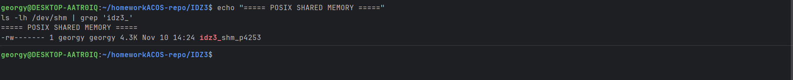
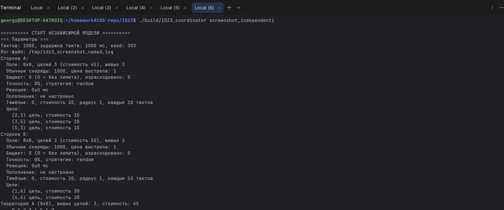
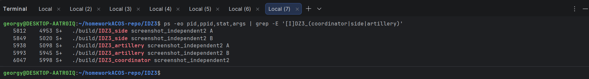
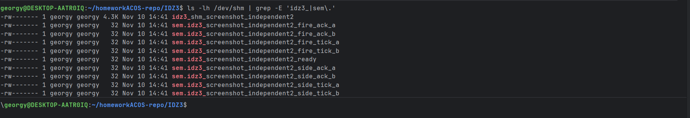
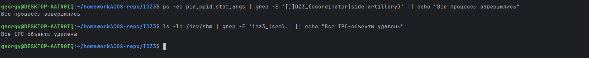

# Отчёт по индивидуальному заданию № 3 — IDZ3

**Дисциплина:** «Архитектура компьютера и операционные системы»<br>
**Тема:** Разработка имитационной программы с использованием взаимодействующих процессов<br>
**Вариант:** 7 — «Два условных государства»<br>
**Исполнитель:** Андрюшко Георгий Павлович<br>
**Группа:** БПИ253<br>
**Москва, 2026**

## 1. Условие задачи

Два условных государства находятся на прямоугольных клеточных территориях. На территориях размещены цели различных типов и стоимости. Стороны независимо и асинхронно обстреливают территорию противника, выбирая координаты случайно или с помощью заданной стратегии. Координаты целей противника заранее неизвестны.

Попадание в неповреждённую цель уничтожает её и уменьшает число и стоимость оставшихся объектов. Повторное попадание в разрушенную или пустую клетку не изменяет состояние территории. Каждая сторона имеет запас обычных и, в расширенной модели, тяжёлых снарядов; боезапас может пополняться с заданной интенсивностью. Стоимость расходуемых боеприпасов может ограничиваться экономическим лимитом.

Стрельба стороны прекращается, если уничтожены все её цели, отсутствуют доступные боеприпасы либо достигнуто экономическое ограничение. Вся модель завершается при прекращении огня обеими сторонами, достижении общего лимита тактов или прерывании пользователем неограниченного по времени моделирования.

Задание №3 требует реализовать участников модели в виде взаимодействующих процессов и организовать обмен данными с помощью POSIX Shared Memory и POSIX-семафоров.

## 2. Сценарий моделирования: сущности и процессы

В проекте используется пять самостоятельных участников:

| Участник | Тип | Обязанности |
| --- | --- | --- |
| Координатор | Процесс | Создаёт/инициализирует модель, запускает или ожидает участников, начинает такты, контролирует завершение и обрабатывает SIGINT/SIGTERM |
| Государство A | Процесс | Пополняет боезапас A, проверяет собственные условия прекращения огня |
| Государство B | Процесс | Пополняет боезапас B, проверяет собственные условия прекращения огня |
| Артиллерия A | Процесс | Независимо выбирает координаты и стреляет по территории B |
| Артиллерия B | Процесс | Независимо выбирает координаты и стреляет по территории A |

Государство и его артиллерия разделены на отдельные процессы, поскольку они являются самостоятельными участниками предметной модели. Государство обслуживает свои параметры и принимает решение о продолжении боя. Артиллерийский процесс расходует боеприпасы, выбирает координаты, выполняет выстрел и меняет только территорию противника посредством зарегистрированного выстрела.

Координатор не стреляет вместо сторон. Он отвечает за жизненный цикл моделирования: выдаёт разрешение на новый такт, принимает подтверждения, проверяет глобальное условие остановки и выводит итоговые результаты.

## 3. Три варианта организации процессов

### 3.1. Родительский процесс и именованные семафоры (4–5 баллов)

Исполняемые файлы: build/IDZ3 и build/IDZ3_named.

Родительский процесс читает конфигурацию, создаёт POSIX Shared Memory, инициализирует process-shared mutex и именованные семафоры через sem_open(), затем создаёт четыре дочерних процесса с помощью fork():

- процесс государства A;
- процесс государства B;
- процесс артиллерии A;
- процесс артиллерии B.

Дочерние процессы получают доступ к одной области разделяемой памяти и синхронизируются именованными POSIX-семафорами. Родительский процесс ожидает их готовность и начинает моделирование. По завершении он устанавливает общий флаг остановки, разблокирует участников семафорами, дожидается их через waitpid() и удаляет созданные IPC-объекты.<br>
**Иллюстрации:** [дерево процессов (рис. 3)](screenshots/03_named_process_tree.png); [Shared Memory и именованные семафоры (рис. 4)](screenshots/04_named_shared_memory_semaphores.png).

### 3.2. Родительский процесс и неименованные семафоры (6 баллов)

Исполняемый файл: build/IDZ3_unnamed.

Распределение процессов и алгоритм моделирования такие же, как в варианте 3.1. Отличается способ представления семафоров: объекты sem_t размещаются непосредственно в области POSIX Shared Memory и инициализируются вызовом:

```c
sem_init(&shared->unnamed_sems[i], 1, 0);
```

Второй аргумент pshared = 1 указывает, что семафор используется разными процессами. При pshared = 0 он был бы предназначен для потоков одного процесса и не решал бы поставленную задачу.<br>
**Иллюстрации:** [дерево процессов (рис. 5)](screenshots/05_unnamed_process_tree.png); [Shared Memory без отдельных именованных семафоров (рис. 6)](screenshots/06_unnamed_shared_memory.png).

### 3.3. Независимо запускаемые программы (7–8 баллов)

Исполняемые файлы:

- build/IDZ3_init — создание сессии и общей памяти;
- build/IDZ3_coordinator — координатор;
- build/IDZ3_side — процесс государства A или B;
- build/IDZ3_artillery — процесс артиллерии A или B;
- build/IDZ3_cleanup — аварийная очистка незавершённой сессии.

Каждый участник является отдельной программой и запускается независимо. Для подключения указывается идентификатор сессии. Программы открывают уже созданную POSIX Shared Memory через shm_open(), отображают её при помощи mmap() и открывают именованные семафоры по сохранённым именам. Координатор начинает моделирование только после регистрации четырёх уникальных ролей: side-A, side-B, artillery-A и artillery-B. Повторная регистрация роли или PID переводит сессию в аварийную остановку. Во время моделирования координатор контролирует PID участников и обнаруживает преждевременное завершение процесса.

Пример ручного запуска из отдельных терминалов:

```bash
./build/IDZ3_init session42 scripts/cases/case1.conf
./build/IDZ3_coordinator session42
./build/IDZ3_side session42 A
./build/IDZ3_side session42 B
./build/IDZ3_artillery session42 A
./build/IDZ3_artillery session42 B
```

Команды после инициализации исполняются в отдельных терминалах. Для автоматической демонстрации тех же отдельных исполняемых файлов предусмотрен scripts/run_independent.sh.<br>
**Иллюстрации:** [координатор (рис. 7)](screenshots/07_independent_coordinator.png); [пять независимых процессов (рис. 8)](screenshots/08_independent_processes.png); [общая память и семафоры (рис. 9)](screenshots/09_independent_shared_memory.png).

## 4. Организация разделяемой памяти

### 4.1. Состав области памяти

В ipc_shared_t размещены:

- сигнатура и версия структуры сессии;
- размер отображаемой области;
- смещения массивов клеток территорий A и B;
- параметры конфигурации и состояние обеих сторон;
- process-shared mutex;
- массив неименованных семафоров (для варианта 6 баллов);
- имена именованных семафоров (для вариантов с sem_open());
- текущий и завершённый такты;
- состояние обработки такта государствами;
- флаг остановки и причина завершения;
- число зарегистрированных и завершившихся рабочих процессов;
- PID четырёх рабочих процессов.

После структуры заголовка в том же отображении памяти располагаются массивы cell_t двух территорий. Размер общей области вычисляется при инициализации на основании размеров карт.

### 4.2. Работа с динамическими массивами

Исходная структура grid_t содержит указатель cells, а исходная реализация выделяла массив через calloc(). Абсолютный указатель процесса нельзя считать универсальным адресом для независимо запущенных процессов: один объект Shared Memory может отображаться в разных виртуальных адресах.

Поэтому в общей структуре сохраняются смещения cells_a_offset и cells_b_offset, а указатели model.A.grid.cells и model.B.grid.cells в копии config_t, хранящейся в Shared Memory, обнуляются. После подключения каждый процесс строит локальное представление конфигурации:

```c
ipc_model_view(shared, &local_config);
```

Функция восстанавливает указатели относительно фактического адреса mmap() данного процесса. Массивы клеток остаются общими, поэтому изменение состояния клетки сразу видно всем участникам. После изменения агрегатов, статистики, боезапаса и прочих полей сторона сохраняется в общей структуре функцией ipc_model_save(); указатели при этом снова обнуляются.

Так сохраняется исходная игровая модель с grid_t и side_t, но устраняется зависимость межпроцессного обмена от абсолютных адресов.

## 5. Синхронизация процессов

### 5.1. Защита общего состояния

Для защиты сложных операций используется robust pthread_mutex_t, инициализированный с атрибутами PTHREAD_PROCESS_SHARED и PTHREAD_MUTEX_ROBUST. Он не создаёт потоков и не заменяет процессную архитектуру: мьютекс применяется как межпроцессная блокировка критической секции. Если владелец умирает внутри критической секции, EOWNERDEAD переводит всю модель в fail-stop: состояние не считается восстановленным, дальнейшие выстрелы запрещаются, участники получают команду остановки, а итоговая причина фиксируется как ошибка.

Под этой блокировкой выполняются:

- чтение и изменение общей статистики;
- проверка условий прекращения огня;
- выбор и регистрация выстрела;
- расход обычного или тяжёлого боеприпаса;
- изменение состояния клетки и агрегатов территории;
- обновление флагов активных сторон;
- запись связанных с операцией сообщений в общий лог.

Это делает операцию «проверить возможность стрельбы → израсходовать снаряд → изменить состояние противника → обновить статистику» неделимой относительно второго артиллерийского процесса.

### 5.2. Семейства семафоров

| Семафор | Назначение |
| --- | --- |
| side_tick_A, side_tick_B | Координатор разрешает государствам обслужить новый такт |
| side_ack_A, side_ack_B | Государства подтверждают обработку такта |
| fire_tick_A, fire_tick_B | В быстром режиме координатор разрешает артиллерии выполнить один выстрел |
| fire_ack_A, fire_ack_B | Артиллерия подтверждает обработку такта |
| ready | Уведомление координатора о регистрации участника |

В родительском варианте 4–5 баллов эти объекты именованные: используются sem_open(), sem_wait(), sem_post(), sem_close() и sem_unlink().

В варианте 6 баллов массив sem_t располагается в общей памяти, а sem_init() вызывается с pshared=1. После завершения вызывается sem_destroy().

В независимом варианте каждый процесс самостоятельно открывает именованные семафоры, что позволяет подключаться к сессии после завершения процесса-инициализатора.

### 5.3. Режимы времени

При tick_ms > 0 координатор последовательно открывает такты для процессов государств, а процессы артиллерии независимо проверяют общие условия готовности к выстрелу. Для огневого подразделения сохраняются задержка реакции и случайный разброс из IDZ2. Если подразделение не готово к моменту смены такта, оно может пропустить этот такт. Лимит max_ticks проверяется после полного интервала последнего такта: при max_ticks=1 обе артиллерии получают время на выстрел первого такта.

При tick_ms = 0 используется строгая синхронизация: после обработки такта государствами координатор отдельно разрешает выстрел каждому артиллерийскому процессу и ожидает оба подтверждения. Каждое подразделение делает не более одного выстрела за такт; задержки реакции не применяются. Благодаря этому лимит тактов не может закончиться до получения артиллерией процессорного времени.

## 6. Сохранённая предметная логика IDZ2

Повторно используются исходные модули:

| Модуль | Сохранённая функциональность |
| --- | --- |
| artillery.c | xorshift32, индивидуальные seed, стратегии random, center, sector, проверка обычного и тяжёлого боезапаса, бюджет |
| side.c | обычный выстрел, тяжёлый площадной залп, пополнение, проверка причин прекращения огня |
| grid.c | прямоугольная территория, состояния клеток, типы и стоимость целей, агрегаты оставшихся целей |
| config.c | значения по умолчанию, проверка конфигурации, интерактивный ввод |
| io.c | построчное чтение с файлового дескриптора через read() |
| log.c | консольный вывод и файл журнала через write() |
| signals.c | SIGINT, SIGTERM и игнорирование SIGPIPE |
| colors.c | ANSI-цвета с автоотключением при перенаправлении stdout |

Изменён исполнительный слой и идентификация участников. В сообщениях артиллерии теперь выводится PID процесса, а не pthread_self(). Библиотеки pthread используются для process-shared mutex; создание рабочих участников выполняется системными процессами, а не pthread_create().

### Условия прекращения огня

Для каждой стороны сохраняются исходные условия:

1. все собственные цели уничтожены;

2. у противника не осталось целей;

3. закончились обычные и тяжёлые боеприпасы;

4. ни один доступный тип боеприпаса нельзя оплатить в рамках оставшегося бюджета.

Пополнение выполняется в начале такта, если (tick + 1) % replenish_every == 0. Тяжёлый залп наносит повреждения неповреждённым целям в квадратной области радиуса area_radius; одна цель учитывается уничтоженной только один раз.

## 7. Пользовательский интерфейс

### 7.1. Родительский режим

```bash
./build/IDZ3 [file.conf]
./build/IDZ3_named [file.conf]
./build/IDZ3_unnamed [file.conf]
./build/IDZ3 --interactive
./build/IDZ3 --help
```

Если файл не указан, используются параметры по умолчанию. Интерактивный ввод сохраняет возможности исходной версии: размеры карт, координаты и типы целей, стоимость объектов, точность, задержки реакции, стратегия, боезапас, пополнение и тяжёлые снаряды.

### 7.2. Независимый режим

```bash
./build/IDZ3_init <session> [config.conf]
./build/IDZ3_coordinator <session>
./build/IDZ3_side <session> A|B
./build/IDZ3_artillery <session> A|B
./build/IDZ3_cleanup <session>
```

Идентификатор сессии ограничен 31 символом и содержит только латинские буквы, цифры, _ и -. Координатор ожидает регистрацию четырёх рабочих процессов, затем запускает модель.

### 7.3. Логирование

Все основные события отображаются в консоли и записываются в лог-файл, указанный ключом log. В лог входят PID, запуск и завершение процессов, номер такта, координаты выстрела, промахи, попадания, уничтоженные цели, остаток боезапаса, стоимость расхода, состояние территорий и итоговая статистика.

В независимом режиме координатор создаёт/очищает лог, а рабочие процессы открывают его в режиме добавления (O_APPEND). Запись событий сериализуется общей process-shared блокировкой, что предотвращает перемешивание сообщений.

## 8. Сборка и запуск

Требуются GCC, CMake и Ninja (или Make):

```bash
sudo apt install build-essential cmake ninja-build
cmake -S . -B build -G Ninja
cmake --build build -j4
```

Базовый сценарий:

```bash
./build/IDZ3 scripts/cases/case1.conf
```

Сценарий с тяжёлыми ударами:

```bash
./build/IDZ3_named scripts/cases/case3_area.conf
```

Неименованные семафоры:

```bash
./build/IDZ3_unnamed scripts/cases/t_tick0.conf
```

Автоматический независимый запуск:

```bash
./scripts/run_independent.sh demo42 scripts/cases/case1.conf
```

## 9. Обработка сигналов и освобождение ресурсов

В родительской модели SIGINT/SIGTERM обрабатывает родительский процесс; дочерние участники игнорируют эти сигналы и получают команду остановки через общий флаг и семафоры. Родитель дожидается каждого ребёнка через waitpid().

В независимой модели сигнал обрабатывает отдельно запущенный координатор. Он выставляет общий флаг остановки, публикует семафорные уведомления и ожидает завершения зарегистрированных участников. После завершения координатор удаляет именованные семафоры и Shared Memory.

В родительских вариантах выполняются sem_close()/sem_unlink() для именованных семафоров либо sem_destroy() для неименованных, pthread_mutex_destroy(), munmap(), close() и shm_unlink(). В независимом варианте штатную очистку выполняет координатор; IDZ3_cleanup предназначен для незавершённой сессии. Результат штатного завершения независимой модели и удаления IPC-объектов показан на [рис. 10](screenshots/10_independent_cleanup.png).

## 10. Результаты тестирования

Набор запускается командой:

```bash
./scripts/run_tests.sh
```

Сценарии IDZ2 были сохранены и использованы для регрессионной проверки неизменности предметной логики. Набор включает 36 проверок: 11 исходных конфигураций в каждом родительском режиме, полный последний такт при max_ticks=1, SIGINT для двух родительских режимов и независимой модели с проверкой очистки IPC, отказ на некорректной конфигурации, обработку EISDIR при read(), нормальный независимый запуск, отклонение повторной регистрации роли, обнаружение SIGKILL независимого рабочего процесса и дочернего процесса fork, fail-stop при EOWNERDEAD и очистку POSIX IPC. Последний запуск scripts/run_tests.sh завершился результатом 36/36.

- стандартные сценарии case1, case3_area;
- тяжёлые удары, использование только тяжёлых снарядов и нулевую стоимость тяжёлого снаряда;
- прекращение по бюджету;
- повторное попадание в уничтоженную клетку;
- пополнение боезапаса;
- минимальное поле и проверку остановки после уничтожения целей;
- типы целей;
- быстрый режим tick_ms=0 и режим с задержкой;
- SIGINT в неограниченном сценарии;
- отказ на некорректной конфигурации;
- независимое подключение четырёх программ к одной сессии;
- отсутствие объектов POSIX Shared Memory после штатного завершения.

При подготовке проекта проверены сборка всех исполняемых файлов, 11 конфигурационных сценариев в каждом из двух родительских вариантов, завершение по SIGINT обоих режимов и независимая сессия из четырёх рабочих программ и координатора. Дополнительно запускается интеграционный скрипт scripts/run_tests.sh; его актуальное число успешных проверок выводится в конце запуска. Итоги чистой сборки и автоматического тестирования приведены на [рис. 1](screenshots/01_build.png) и [рис. 2](screenshots/02_tests.png).

## 11. Инварианты

| Инвариант предметной задачи | Механизм реализации |
| --- | --- |
| Выстрел расходует не более одного снаряда | Одна функция попытки выстрела выбирает ровно один тип боеприпаса; операция защищена общей блокировкой |
| Цель уничтожается только один раз | Уничтожаются только клетки CELL_TARGET; после попадания состояние меняется на CELL_DESTROYED |
| Стоимость и число целей неотрицательны | Агрегаты уменьшаются только при переходе живой цели в уничтоженную; повторное попадание не меняет их |
| Артиллерия атакует только территорию противника | side_fire(shooter, victim) и side_area_strike(shooter, victim) получают противника как victim; государство не выбирает свою территорию целью |
| После прекращения огня не происходит новых выстрелов | Перед каждым выстрелом повторно проверяется active под общей блокировкой |
| Координатор завершает всех участников | Общий stopping, семафорные уведомления и waitpid() либо ожидание регистрации/завершения в независимом режиме |

## 12. Структура исходного проекта

```text
IDZ3/
├── CMakeLists.txt
├── README.md
├── REPORT.md
├── REPORT.docx
├── .gitignore
├── include/
│   ├── ipc.h
│   ├── process_simulation.h
│   ├── simulation.h
│   ├── artillery.h
│   ├── side.h
│   ├── grid.h
│   ├── config.h
│   ├── log.h
│   ├── io.h
│   ├── signals.h
│   └── colors.h
├── src/
│   ├── main.c
│   ├── ipc.c
│   ├── process_simulation.c
│   ├── artillery.c
│   ├── side.c
│   ├── grid.c
│   ├── config.c
│   ├── log.c
│   ├── io.c
│   ├── signals.c
│   ├── colors.c
│   └── independent/
│       ├── init_main.c
│       ├── coordinator_main.c
│       ├── side_main.c
│       ├── artillery_main.c
│       └── cleanup_main.c
├── scripts/
│   ├── run_tests.sh
│   ├── run_independent.sh
│   └── cases/
├── tests/
│   └── hold_mutex.c
└── screenshots/
    ├── 01_build.png
    ├── 02_tests.png
    ├── 03_named_process_tree.png
    ├── 04_named_shared_memory_semaphores.png
    ├── 05_unnamed_process_tree.png
    ├── 06_unnamed_shared_memory.png
    ├── 07_independent_coordinator.png
    ├── 08_independent_processes.png
    ├── 09_independent_shared_memory.png
    └── 10_independent_cleanup.png
```
## 13. Изменения относительно IDZ2

1. Исполнительная модель с pthread_create() заменена на fork() / отдельные исполняемые файлы.

2. Общее состояние вынесено в POSIX Shared Memory (shm_open, ftruncate, mmap, munmap, shm_unlink).

3. Добавлены именованные POSIX-семафоры для режимов 4–5 и 7–8 баллов.

4. Добавлены неименованные POSIX-семафоры в общей памяти с pshared=1 для уровня 6 баллов.

5. Добавлены независимо запускаемые процессы IDZ3_side и IDZ3_artillery, самостоятельный инициализатор и координатор.

6. Добавлена регистрация четырёх уникальных ролей и PID; дубликаты ролей и PID отклоняются.

7. Добавлен мониторинг жизни независимых процессов, обработка преждевременного завершения, EOWNERDEAD и безопасная остановка при аварии.

8. Исправлена обработка последнего временного такта при ограничении max_ticks; ошибка read() больше не маскируется под EOF.

## 14. Иллюстрации результатов сборки и тестирования

Скриншоты ниже фиксируют фактические результаты сборки, регрессионных проверок и запуска трёх процессных вариантов. Изображения встроены в документ; ссылки на соответствующие рисунки размещены в разделах с описанием реализаций и тестирования.

### 14.1. Сборка и автоматизированное тестирование

**Рисунок 1 — Чистая сборка всех исполняемых вариантов проекта IDZ3.**



**Рисунок 2 — Итог автоматизированного тестирования: успешно выполнено 36 из 36 проверок.**



### 14.2. Родительский процесс и именованные POSIX-семафоры

**Рисунок 3 — Дерево процессов варианта IDZ3_named: родительский процесс и четыре дочерних процесса.**



**Рисунок 4 — Объект POSIX Shared Memory и девять именованных POSIX-семафоров варианта IDZ3_named.**



### 14.3. Родительский процесс и неименованные POSIX-семафоры

**Рисунок 5 — Дерево процессов варианта IDZ3_unnamed: родительский процесс и четыре дочерних процесса.**



**Рисунок 6 — Объект POSIX Shared Memory в варианте с неименованными семафорами; отдельные именованные семафоры не создаются.**



### 14.4. Независимо запускаемые программы

**Рисунок 7 — Запуск координатора независимой модели и отображение параметров сессии.**



**Рисунок 8 — Пять независимо запускаемых программ с различными PID и PPID.**



**Рисунок 9 — Общий объект POSIX Shared Memory и девять именованных семафоров независимой сессии.**



### 14.5. Штатное завершение и очистка IPC-ресурсов

**Рисунок 10 — Проверка после штатного завершения координатора: процессы и IPC-объекты отсутствуют.**


